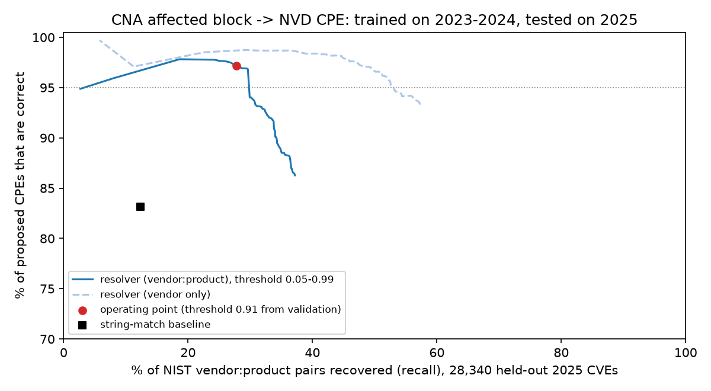

# SBOM Truth Check

A command-line auditor for security, vulnerability-management and compliance analysts. It checks a vendor SBOM against CISA's minimum elements and against the project's lockfile, and `cpeinfer` proposes NVD CPEs (or abstains) for CVEs that NIST no longer enriches, so CPE-matching scanners stop missing them.

## Results

- **None of 88 generator SBOMs from Syft, Trivy and CycloneDX tools met CISA's minimum elements.** Only 21.6% carried component hashes and 0% stated a generation context (`results/summary.json`).
- **Recovered NVD CPEs for held-out 2025 CVEs at 97.2% precision, against 83.1% for plain string matching, while more than doubling recall (27.8% vs 12.4%).** Trained on 2023-2024 only, tested on 28,340 NIST-enriched 2025 CVEs (`results/cpeinfer/report.md`).
- **Proposed CPEs for 4,104 of 27,714 CVEs that NIST left unenriched** (mostly "Deferred", the backlog NVD no longer schedules), at the same 95%-precision operating point.
- **Explained all 13,489 SBOM-vs-lockfile disagreements by a named cause, with 0 unexplained.** 80 pytest tests pass, including Hypothesis planted-error tests and brute-force checks of version-range translation.



**Stack:** Python 3.11+, pandas, NumPy, ijson, CVE JSON 5 (cvelistV5), NVD CVE 2.0 feeds, NVD CPE Dictionary 2.0, CycloneDX 1.5–1.7, SPDX 2.3, Package URL (PURL), Syft, Trivy, cyclonedx-npm, cyclonedx-py, pytest, Hypothesis, matplotlib

## Quickstart

```bash
python3 -m sbomcheck diff corpus/koa/sboms/syft.cdx.json corpus/koa/src/package-lock.json
python3 -m cpeinfer evaluate --train-years 2023 2024 --test-year 2025 --min-precision 0.95 --must-beat-baseline
python3 -m cpeinfer resolve CVE-2025-0395 CVE-2025-0638 CVE-2025-27152
```

The SBOM checker uses only the standard library. `cpeinfer` needs `pip install -r requirements-dev.txt`; on its first run `evaluate` downloads the public inputs (about 70 MB of NVD feeds, an 81 MB CPE dictionary and a sparse cvelistV5 checkout) into `data/`, then takes about 4 minutes and 1.8 GB of memory.

## Why

In 2025, CISA revised the SBOM minimum elements. The revision adds component hash and hash algorithm, license, the renamed *Component Producer*, document-level fields, and an explicit requirement to include transitive dependencies ([BankInfoSecurity: "CISA's New SBOM Rules Face Old Adoption Problem"](https://www.bankinfosecurity.com/cisas-new-sbom-rules-face-old-adoption-problem-a-32416)). Practitioners quoted there say the missing pieces are conformance testing and evidence that SBOMs are accurate. Independent work reaches a similar conclusion: a TUM study of Maven SBOM generators (cdxgen, Trivy, Syft, jbom, GitHub Dependency Graph) found that the tools disagree on components and transitive dependencies and that "none of these tools can be regarded as the perfect and optimal approach" ([TUM i20 thesis](https://www.sec.in.tum.de/i20/student-work/analyzing-deficits-in-java-maven-sbom-creation-and-identifying-optimization-potentials)).

This project gives an analyst who receives an SBOM two answers:

1. Does it carry every required element, and where exactly is each one missing (a JSON path per failure)?
2. Does it describe the real dependency graph? This is checked against ground truth derived independently from the lockfile, without running any SBOM generator.

## Example: checking a vendor SBOM against its lockfile

```text
$ python3 -m sbomcheck conform corpus/koa/sboms/syft.cdx.json
  FAIL  sbom_author                1/1 locations failing
          $.metadata.authors: no SBOM author (metadata.authors/manufacturer)
  FAIL  component_hash             36/36 locations failing
          $.components[0].hashes: no hash
  FAIL  transitive_completeness    36/36 locations failing
          $.components[0]: not reachable from the primary component through dependency edges
  ...
$ python3 -m sbomcheck diff corpus/koa/sboms/syft.cdx.json corpus/koa/src/package-lock.json
  components all        precision 100.0%  recall 100.0%  (matched 35, reported 35, expected 35)
  edges      all        precision  73.2%  recall 100.0%  (matched 41, reported 56, expected 41)
  [edge_to_wrong_version] 15
      extra_edge: ROOT -> pkg:npm/content-type@2.0.0
      ... 14 more
```

In this example, Syft lists the right packages but links each package to every installed version of a dependency name (for example, koa to both `content-type` 1.0.5 and 2.0.0), not only to the one the lockfile resolves. Add `--json` to get machine-readable output. Add `conform --strict` or `diff --fail-on-unexplained` to make the command exit non-zero, for use as a CI gate.

## How it works

```
sbomcheck/
  purl.py         PURL parser + per-ecosystem canonicalization (PEP 503/440, npm scope, Maven qualifiers)
  sbom.py         CycloneDX / SPDX JSON -> components, root aliases, dependency edges
  lockfiles.py    ground truth: package-lock v2/v3, poetry.lock (+pyproject.toml), mvn dependency:tree (+pom.xml)
  conformance.py  per-field CISA minimum-element verdicts with JSON paths
  diff.py         component/edge precision-recall (direct vs transitive) + mismatch cause classifier
  evaluate.py     corpus run -> results/summary.json, per_sbom.json, mismatches.csv, report.md
```

- **Ground truth.** The reference set is what ships: every locked package outside dev/test scope, including optional and platform-conditional packages, which are flagged as such.
  - npm: the resolver reproduces Node's nested `node_modules` lookup to find which copy each package actually uses, so `a → b@2` is not confused with a hoisted `b@1`.
  - Poetry: it reads lock 2.x `groups`/`markers` (and 1.x `category`) and takes direct dependencies from PEP 621 or `tool.poetry` tables.
  - Maven: it parses `dependency:tree` with scopes and `(optional)` markers, and reads `pom.xml` to find dependencies that exist only in profiles or plugin configuration.
- **Canonicalization.** Two PURLs compare equal when they name the same artifact:
  - `pkg:PyPI/Typing_Extensions@4.9.0` equals `pkg:pypi/typing-extensions@4.9`.
  - `%40Babel` equals `@babel`.
  - `?type=jar` is dropped as the Maven default.
  - Tool-specific qualifiers such as Syft's `package-id` are ignored.
  - npm package names and Maven coordinates stay case-sensitive, because their registries are.
- **Cause classes.** Every disagreement gets exactly one cause:

  | Class | Meaning |
  |---|---|
  | `dev_test_dependency_included` | dev/test/provided-scope package (or edge) reported as shipped |
  | `optional_or_platform_dependency` | optional, extras-only or platform/python-marker package or edge, included or omitted |
  | `bundled_vendored_package` | package shipped inside another (`inBundle`) |
  | `name_normalization_mismatch` | same artifact, different spelling; resolved by canonicalization |
  | `range_instead_of_locked_version` | version range, property (`${x}`) or missing version instead of the locked one |
  | `different_locked_version` | concrete version that differs from the lockfile |
  | `missing_transitive_dependency` | indirect package absent from the SBOM |
  | `missing_direct_edge` / `missing_transitive_edge` | both packages present, the dependency edge between them is missing |
  | `no_dependency_graph` | SBOM states no edges at all |
  | `transitive_reported_as_direct` | an indirect dependency drawn as a direct one |
  | `edge_to_wrong_version` | edge points to another installed version of the right package |
  | `inactive_build_profile_dependency` | declared only in a Maven profile or plugin config, not in the default build |
  | `duplicate_component` | same canonical component listed more than once |
  | `component_without_purl` | component that cannot be identified |
  | `unexplained` | residue; `--fail-on-unexplained` fails if any remain |

## CVE → CPE inference for unenriched CVEs (`cpeinfer`)

Since spring 2026 NIST no longer enriches most CVEs with CPE data. In the NVD feeds this backlog is marked `Deferred` (27,374 of the unenriched 2023-2025 records here), and only KEV, federal-use and EO 14028 critical software still get CPEs ([Infosecurity Magazine](https://infosecurity-magazine.com/news/nvd-enrichment-premarch-2026), [CSA research note](https://labs.cloudsecurityalliance.org/research/csa-research-note-nist-nvd-enrichment-overhaul-20260429-csa/)). A scanner that matches on CPE silently misses everything else. Guessing `vendor:product` is a precision problem: one wrong CPE raises false alerts across a whole fleet. So the resolver gives a calibrated confidence and abstains below a threshold chosen for 95% precision.

```
cpeinfer/
  versions.py   generic version order; CNA versions/lessThan/lessThanOrEqual/changes/defaultStatus -> cpeMatch ranges
  data.py       streams cvelistV5, NVD CVE 2.0 feeds (ijson) and the CPE dictionary into data/built/
  resolver.py   alias model, candidate generation, logistic scorer, string-match baseline
  evaluate.py   time split, threshold choice on validation, metrics, unenriched coverage
  gaps.py       SBOM PURLs -> CPEs -> CVE hits that CPE-only matching misses
```

- **Alias model.** For every CVE that NIST enriched in the training window, each CNA affected entry is aligned with the NVD `vendor:product` it describes (the CNA's own `cpes`, a single entry, or the most similar name). The model counts how often each key mapped to each CPE: the normalized vendor+product, the product, CNA+product, and the package URL built from `packageURL`, `collectionURL`+`packageName` or a GitHub `repo` with SBOM Truth Check's PURL canonicalization.
- **Candidates.** Candidates come from those aliases, from CPEs the CNA listed, and from the NVD CPE dictionary by normalized tokens (exact name, vendor aliases, product-token overlap within the vendor). Deprecated names are followed along their `deprecatedBy` chain to the current name.
- **Scoring.** A logistic regression (NumPy, Newton's method) over 20 features: alias shares and counts, name similarity, rename flag, popularity, and whether the dictionary versions of the candidate fall inside the CNA's affected range.
- **No time leakage.** Aliases are learned from CVEs published before 1 July 2024. The scorer and threshold come from the second half of 2024, with 5-fold cross-fitted probabilities; validation precision at threshold 0.91 is 96.1%. For the 2025 test, aliases are re-learned from all of 2023-2024, and the CPE dictionary is cut to entries created before 1 January 2025, so CPEs NIST created while enriching 2025 CVEs are invisible.
- **Version ranges.** CNA `versions` lists (semver, custom, `lessThan`, `lessThanOrEqual`, `4.19.*` branch bounds, `changes`, `defaultStatus`, GitHub-style `"< 1.8.2"`) become the minimal list of `versionStart*/versionEnd*` ranges. Hypothesis checks that the translated ranges flag exactly the versions a brute-force evaluation of the CNA rules flags.

Held-out 2025 results (`results/cpeinfer/report.md`, `metrics.csv`, `precision_coverage.csv`, `calibration.csv`):

| Field | Resolver precision | Resolver recall | String-match precision | String-match recall |
|---|---|---|---|---|
| vendor | 98.7% | 36.5% | 95.3% | 24.0% |
| vendor:product | 97.2% | 27.8% | 83.1% | 12.4% |
| version range (exact match with NVD) | 17.1% | 4.9% | 31.4% | 4.7% |

At the baseline's own precision (83.1%) the resolver's recall is 37.2%. Recall is measured against every NIST `vendor:product` pair of the 28,340 test CVEs. This includes CVEs whose CNA wrote `n/a` and products that only got a CPE in 2025, which no method could reach. On correct pairs the translated ranges have a mean Jaccard overlap of 66.8% with NIST's. Exact range agreement is low because NIST often splits, widens or narrows ranges relative to the CNA's statement.

Run it on your own data:

```bash
python3 -m cpeinfer resolve path/to/CVE-2025-1234.json path/to/cve-dir/ CVE-2025-27152 --json   # proposed configurations, or "abstain" below the threshold
python3 -m cpeinfer sbom-gaps your-sbom.cdx.json corpus/*/sboms/syft.cdx.json                   # writes results/cpeinfer/sbom_gaps.{csv,md}
```

`sbom-gaps` reads components through SBOM Truth Check's loader and PURL canonicalization. A component is joined to a CVE when one of the CVE's CNA affected entries has the same canonical package URL, or when both resolve to the same CPE and the component's own resolution clears the threshold. The component's version must also fall inside the translated range. The command then lists the hits that NVD CPE matching would miss, because the CVE is not enriched, its configuration does not name the product, or its range excludes the version. On the corpus's 20 Syft SBOMs, it finds 15 CVE hits among 638 components; 8 of them CPE-only matching misses (`results/cpeinfer/sbom_gaps.md`).

## Full results (SBOM generators)

Generated by `python3 -m sbomcheck evaluate --corpus corpus --out results`. The full report is in [results/report.md](results/report.md), and every individual mismatch with its cause is in `results/mismatches.csv`.

| Tool (format) | SBOMs | Component precision | Component recall | Edge precision | Edge recall | Transitive edge recall |
|---|---|---|---|---|---|---|
| cyclonedx-npm (cdx) | 7 | 2.7% | 100.0% | 1.8% | 100.0% | 100.0% |
| cyclonedx-py (cdx) | 2 | 11.4% | 27.5% | 7.2% | 27.6% | 21.9% |
| syft (cdx) | 20 | 45.0% | 100.0% | 25.7% | 86.2% | 100.0% |
| syft (spdx) | 20 | 45.0% | 100.0% | 25.7% | 86.2% | 100.0% |
| trivy (cdx) | 20 | 100.0% | 99.0% | 99.5% | 98.9% | 99.2% |
| trivy (spdx) | 19 | 100.0% | 99.0% | 99.2% | 70.7% | 99.2% |

CISA conformance, as the share of all 88 SBOMs that pass each field:

| Field | Pass rate | Field | Pass rate |
|---|---|---|---|
| sbom_author | 44.3% | component_producer | 13.6% |
| timestamp | 100.0% | component_hash | 21.6% |
| tool_name | 100.0% | license | 46.6% |
| generation_context | 0.0% | dependency_relationships | 63.6% |
| component_name / version / identifier | 100% / 98.9% / 100% | transitive_completeness | 39.8% |

Findings that only show up against ground truth:

- With default settings, cyclonedx-npm and Syft include dev/test packages. Dev/test packages account for 12,805 of the 13,489 mismatches.
- Trivy's SPDX output describes the lockfile with `CONTAINS` but has no `DEPENDS_ON` from it, so the direct edges disappear. Its edge recall is 70.7% in SPDX against 98.9% in CycloneDX.
- Syft links a package to every installed version of a dependency name (`edge_to_wrong_version`). For `pom.xml` it reports unresolved `${property}` versions and dependencies that appear only in profiles.

## Corpus

`corpus/repos.json` pins 20 repositories by commit: 8 npm, 7 Poetry and 5 Maven. Each `corpus/<name>/src/` holds the pinned manifest and lockfile; for Maven, `dependency-tree.txt` comes from `mvn dependency:tree`. Each `corpus/<name>/sboms/` holds the generated SBOMs. To rebuild:

```bash
./scripts/fetch_corpus.sh      # download lockfiles at the pinned commits, run mvn dependency:tree
./scripts/generate_sboms.sh    # cyclonedx-npm 6.0.1, cyclonedx-py 7.5.0, Syft 1.54.1, Trivy 0.75.0
python3 -m sbomcheck evaluate --corpus corpus --out results --fail-on-unexplained
python3 scripts/plot_results.py   # needs matplotlib; writes docs/tool_accuracy.png
```

The committed SBOMs were produced with cyclonedx-npm 6.0.1, cyclonedx-py 7.5.0, Syft 1.54.1 and Trivy 0.75.0. When a generator crashes, its message is kept as `<tool>.error.txt` and listed in the report. These failures are part of the result:

- cyclonedx-py fails on Poetry 2 projects that keep their metadata in a PEP 621 `[project]` table.
- cyclonedx-npm fails when `npm ls` finds the lockfile out of sync with `package.json` (winston).
- Trivy SPDX for commons-text hit a Maven Central rate limit (HTTP 429).

## Tests

```bash
pip install -r requirements-dev.txt   # pytest, hypothesis (+ matplotlib, cyclonedx-bom for the scripts)
python3 -m pytest -q
```

The suite has 80 tests:

- `tests/test_purl.py`: hand-worked canonicalization cases, covering both PURLs that must be equal and PURLs that must stay distinct.
- `tests/test_planted.py`: Hypothesis tests. Each one builds a random dependency graph with a matching lockfile and fully conformant CycloneDX and SPDX SBOMs, plants one defect, and asserts that exactly that defect is reported (field, JSON path and cause).
- `tests/test_lockfiles.py`: resolver and classifier cases on small hand-written lockfiles.
- `tests/test_cli.py`: end-to-end runs of the CLI on the corpus (the `cpeinfer` run is skipped until `data/` is built).
- `tests/test_cpeinfer_versions.py`: Hypothesis brute-force agreement between CNA version semantics and translated cpeMatch ranges, plus hand-worked kernel and GitHub-advisory shapes.
- `tests/test_cpeinfer_alias.py`: planted aliases (a CNA's private vendor/product spelling, a package URL, a renamed CPE) that the resolver must recover, CPE escaping and the dictionary cutoff.

## Design notes

- **Reference set = shipped graph.** Dev/test packages are part of the lockfile but not of the product. An SBOM that lists them is counted as over-reporting, and each one is labelled `dev_test_dependency_included`, so a team with the opposite policy can filter that class out of `mismatches.csv`.
- **Optional/platform packages stay in the reference set but are labelled.** A tool that omits them loses recall, and the cause makes the reason visible. For this reason cyclonedx-py's low recall on `rich`/`textual` mostly reflects optional extras it leaves out by default.
- **Hash rule.** The checker accepts a hash with an algorithm and a hex value of the right length, either on the component or on its distribution reference (which is where cyclonedx-npm puts the npm `integrity` hash). A SHA-512 value labelled `SHA-1` fails.
- **SPDX 2.3 has no lifecycle field.** Generation context passes only when `creationInfo.comment` names a phase (build, source, analyzed and so on).
- **Root aliasing.** The scanned directory, the lockfile "application" entries and the project's own package all map to `ROOT`, so tools that wrap their graph differently can still be compared edge for edge.
- Each tool is run once in its default mode, which is what a vendor would most likely ship. Precision and recall are micro-averaged over all SBOMs of a tool.

## Limitations and next steps

- Ground truth is limited to npm lockfile v2/v3, poetry.lock and single-module `mvn dependency:tree` text. npm lockfile v1, yarn and pnpm, pip/uv lockfiles, Gradle and multi-module Maven builds are not parsed. One candidate repository (node-http-proxy, lockfile v1) was replaced for this reason.
- Maven ground truth is only as good as `mvn dependency:tree` without `-Dverbose`: conflict-losing versions are not shown, and the profile check only reads the module's own `pom.xml`, not its parents.
- npm workspaces/monorepos are not covered: the cyclonedx-npm run needs the workspace sources, which the corpus does not vendor.
- The corpus is small for some generators. cyclonedx-py produced SBOMs for only 2 of 7 Poetry projects, and there is one SBOM per tool per repository, all from default settings. Running each tool with its "production only" options would show how much of the gap is configuration rather than capability.
- All 13,489 mismatches are classified, but the classification is rule-based. It explains the corpus completely and the planted tests check each class, but a new generator behaviour could still land in `unexplained`; the `--fail-on-unexplained` gate exists to surface that case.
- Conformance checks that the elements are present and well-formed. It does not verify that a hash matches the real artifact or that a license is correct. Downloading artifacts to confirm hashes would be the next step.
- No vulnerability scanner of its own (`cpeinfer` outputs CPE configurations and a gap list), no LLM or paid API, no container-image SBOMs, no SBOM generation and no web UI; these are out of scope.
- `cpeinfer` covers about 28% of NIST's `vendor:product` pairs at 97% precision. Most misses are CVEs whose CNA writes `n/a` or free text, or products whose CPE did not exist before the cutoff; inventing new CPE names is out of scope.
- Exact version-range agreement with NIST is 17%. The translation is faithful to the CNA's statement (Hypothesis-checked), but CNAs and NIST often disagree. For example, pip's CVE-2023-5752 lists only `23.3` as unaffected with `defaultStatus: affected`, so pip 26.2.1 counts as affected. Learning per-CNA conventions would be the next step.
- The SBOM join maps a component to a CPE with the scorer trained on CNA entries and does not check the ecosystem. It maps PyPI `babel` to `babeljs:babel`, which shows up in the gap list. An ecosystem guard and a component-trained scorer would fix this.
- CNA records are taken from cvelistV5 as of the download date. A CNA may have revised an affected block after NIST enriched the CVE, which slightly favours the training labels.

Project period: 2026-09-24 to 2026-09-29; `cpeinfer` added 2026-10-09.

Project period: 2026-09-24 to 2026-10-08.
