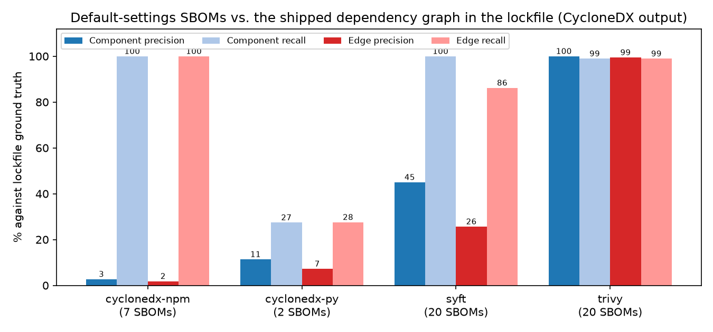

# SBOM generator results

Generated by `python3 -m sbomcheck evaluate --corpus corpus --out results`. The full report is [results/report.md](../results/report.md), and every mismatch with its cause is in `results/mismatches.csv`.

## Accuracy against lockfile ground truth

Micro-averaged over all SBOMs of a tool, each tool run once in its default mode.

```text
tool (format)        SBOMs  comp P   comp R   edge P   edge R   transitive edge R
cyclonedx-npm (cdx)    7     2.7%   100.0%     1.8%   100.0%   100.0%
cyclonedx-py (cdx)     2    11.4%    27.5%     7.2%    27.6%    21.9%
syft (cdx)            20    45.0%   100.0%    25.7%    86.2%   100.0%
syft (spdx)           20    45.0%   100.0%    25.7%    86.2%   100.0%
trivy (cdx)           20   100.0%    99.0%    99.5%    98.9%    99.2%
trivy (spdx)          19   100.0%    99.0%    99.2%    70.7%    99.2%
```



## CISA minimum elements

Share of all 88 SBOMs passing each field:

```text
sbom_author               44.3%     component_producer        13.6%
timestamp                100.0%     component_hash            21.6%
tool_name                100.0%     license                   46.6%
generation_context         0.0%     dependency_relationships  63.6%
component_name           100.0%     transitive_completeness   39.8%
component_version         98.9%
component_identifier     100.0%
```

## Findings

- cyclonedx-npm and Syft include dev/test packages by default. These make up 12,805 of the 13,489 mismatches.
- Trivy's SPDX output describes the lockfile with `CONTAINS` but has no `DEPENDS_ON` from it, so direct edges disappear (edge recall 70.7% in SPDX against 98.9% in CycloneDX).
- Syft links a package to every installed version of a dependency name. For `pom.xml` it reports unresolved `${property}` versions and profile-only dependencies.
- cyclonedx-py's low recall on `rich` and `textual` mostly reflects optional extras it leaves out by default.

## Corpus

`corpus/repos.json` pins 20 repositories by commit: 8 npm, 7 Poetry and 5 Maven. `corpus/<name>/src/` holds the manifest and lockfile (plus `dependency-tree.txt` for Maven), and `corpus/<name>/sboms/` holds the generated SBOMs. To rebuild:

```bash
./scripts/fetch_corpus.sh      # lockfiles at the pinned commits, mvn dependency:tree
./scripts/generate_sboms.sh    # cyclonedx-npm 6.0.1, cyclonedx-py 7.5.0, Syft 1.54.1, Trivy 0.75.0
python3 -m sbomcheck evaluate --corpus corpus --out results --fail-on-unexplained
python3 scripts/plot_results.py   # needs matplotlib; writes docs/tool_accuracy.png
```

When a generator crashes, its message is kept as `<tool>.error.txt` and listed in the report:

- cyclonedx-py fails on Poetry 2 projects that keep metadata in a PEP 621 `[project]` table.
- cyclonedx-npm fails when `npm ls` finds the lockfile out of sync with `package.json` (winston).
- Trivy SPDX for commons-text hit a Maven Central rate limit (HTTP 429).

One candidate repository (node-http-proxy) was replaced because it uses npm lockfile v1, which the ground-truth parser doesn't read. Maven ground truth is only as good as `dependency:tree` without `-Dverbose`, and the profile check reads only the module's own `pom.xml`, not its parents.
